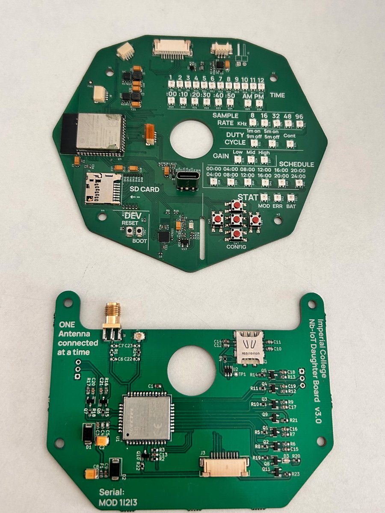
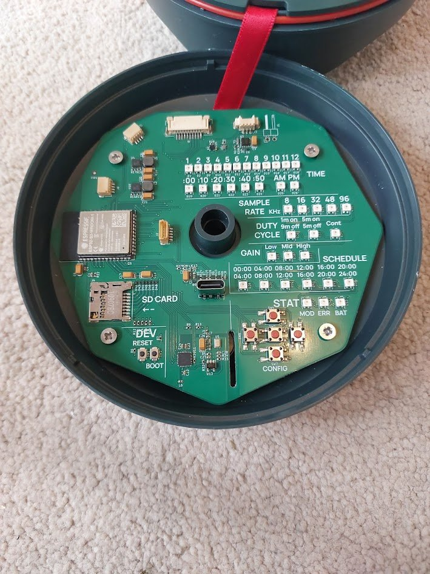
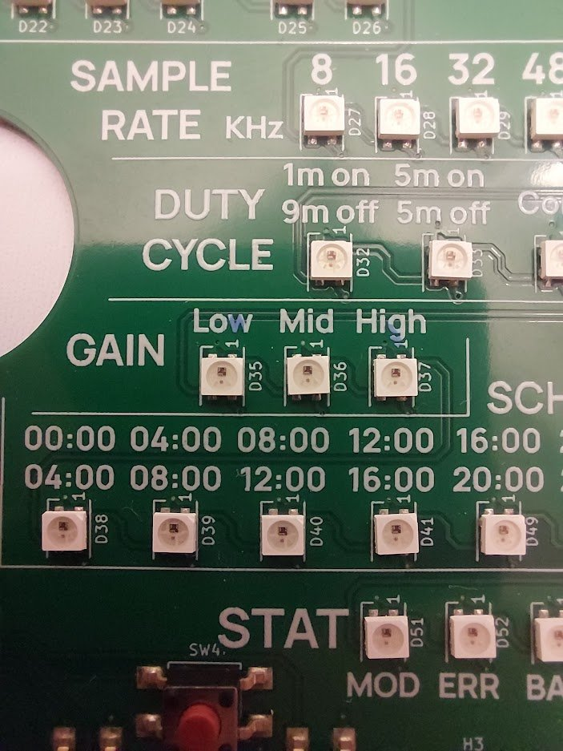
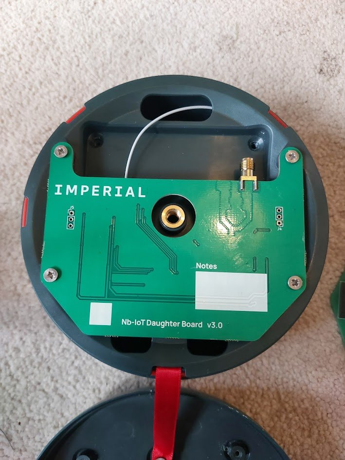

# Locust Hardware

Open hardware for **Locust**, a low-cost acoustic monitoring sensor developed with Imperial College London. It records audio to a microSD card in the field and can optionally send data over NB-IoT through a plug-in daughter board.

This repository contains the KiCad design files, manufacturing outputs and a firmware flashing tool for the electronics.

<p align="center">
  
</p>

## Boards

| Board | Description | Latest release |
|-------|-------------|----------------|
| [IC_001 - Low Cost Audio Sensor](IC_001%20-%20Low%20Cost%20Audio%20Sensor/) | Main board: ESP32-S3 audio recorder with microSD storage and Li-ion battery management | v3.0 |
| [IC_002 - Acoustic Nb-IoT Daughter Board](IC_002%20-%20Acoustic%20Nb-IoT%20Daughter%20Board/) | Optional NB-IoT add-on board for sending data off the device | v3.0 |

### IC_001 – Low Cost Audio Sensor

- **MCU:** Espressif ESP32-S3-WROOM-1 (N16R8: 16 MB flash, 8 MB PSRAM)
- **Audio chain:** Syntiant SPV0142LR5H analogue MEMS microphone → TI OPA1671 preamp → TI TLV320ADC3101 audio ADC (I2S)
- **Storage:** microSD card
- **Power:** single-cell Li-ion input, TI BQ21080 charger, TI BQ27427 fuel gauge, 2× TI TPS63000 buck-boost regulators, USB-C for charging and programming
- **User interface:** 5 buttons and an addressable RGB LED panel for setting the clock, sample rate (8–96 kHz), duty cycle, gain and recording schedule, plus status LEDs
- **Expansion:** 2× Qwiic/STEMMA QT (JST-SH, I2C) and a 10-way FFC connector (J6) to IC_002

<p align="center">
  
  
</p>

### IC_002 – Acoustic NB-IoT Daughter Board

- **Modem:** Quectel BC65 NB-IoT module
- **SIM:** nano-SIM holder with ESD protection
- **Antenna:** edge-mount SMA or U.FL (fit **one** antenna at a time)
- **Interface:** 10-way FFC connector (J3) to IC_001, with level-shifted UART and modem power/reset control

<p align="center">
  
</p>

## Repository layout

Each board follows the same structure:

```
IC_00X - <Board Name>/
  working/                              KiCad project (in-progress design)
  IC_00X - <Board Name> - Release vX.Y/
    ... - Schematics - vX.Y.pdf
    ... - Layer Drawings - vX.Y.pdf
    ... - vX.Y.step                     3D model of the assembled board
    ... - proj files - vX.Y.zip         KiCad project snapshot for this release
    front.png / back.png                Board renders
    manufacturing files/
      BoM / PnP (JLC and EXT)           Bill of materials and pick-and-place files
      <gerber folders and zip>          Gerbers (RS-274X and X2) and drill files
firmware/                               Pre-built test firmware binaries
uploader/                               Windows flashing tool (Python source)
```

**JLC** files are formatted for JLCPCB assembly (LCSC part numbers). **EXT** files are for any other assembler and list manufacturer and Digi-Key part numbers.

Use the **v3.0** releases for new builds. The v1.0 releases are kept for reference.

## Building a unit

A complete unit needs:

| Item | Part |
|------|------|
| Main board | IC_001 v3.0 |
| NB-IoT board (optional) | IC_002 v3.0 |
| Board-to-board cable | Molex 15167-0250 FFC |
| Antenna | KYOCERA AVX 9000440F0-AA12L0150 (U.FL) |
| Battery | 3× 18650 cells in parallel (1S3P), see below |
| Enclosure | Injection-moulded enclosure, not included in this repo |

### Battery

- 1S3P 18650 pack, 4.2 V fully charged, about 9000 mAh
- Connector: Molex PicoBlade housing 51021-0300, mates with J3 on IC_001
  - Pin 1: battery +
  - Pin 2: thermistor, 10 kΩ NTC (optional)
  - Pin 3: battery −

> ⚠️ Check the polarity before connecting. Many off-the-shelf PicoBlade battery leads are wired the other way round.

## Flashing firmware

Pre-built test firmware is in [`firmware/`](firmware/). The firmware source code is not part of this repository.

### Windows (updater tool)

1. Put `updater.exe` in the same folder as `bootloader.bin`, `partitions.bin` and `firmware.bin`.
2. Connect IC_001 to your PC with a USB-C **data** cable.
3. Run `updater.exe`. The tool is unsigned, so if Windows SmartScreen warns you, click **More info → Run anyway**.
4. Select the board's COM port (check Device Manager if you are unsure which one it is) and click **Flash Firmware**.
5. Wait for the success message.

If the board isn't detected, hold **BOOT**, press **RESET**, then release **BOOT** to enter download mode.

### Any platform (esptool)

```bash
pip install esptool
esptool.py --chip esp32s3 --port <PORT> --baud 460800 write_flash -z \
  0x0 bootloader.bin \
  0x8000 partitions.bin \
  0x10000 firmware.bin
```

### Building the updater from source

```bash
cd uploader
pip install -r requirements.txt pyinstaller
pyinstaller updater.spec
```

The executable is written to `uploader/dist/updater.exe`.

## Design tools

- **ECAD:** KiCad. Some parts use a custom `SR_*` library, which is not included. KiCad stores footprints inside the board file and symbols inside the schematic, so the projects open and can be edited without that library. Library paths use the `${SR_KICAD_LIB}` path variable.
- **Gerbers:** provided in both standard RS-274X and Gerber X2 formats

## License

The hardware designs are released under the [CERN Open Hardware Licence Version 2 – Permissive](LICENSE) (CERN-OHL-P-2.0).

The updater software in [`uploader/`](uploader/) is released under the [MIT License](uploader/LICENSE).

Copyright © 2026 Ryan Smith.

## Acknowledgements

Designed by [Smith Robotics](https://smithrobotics.co.uk) for Imperial College London.
